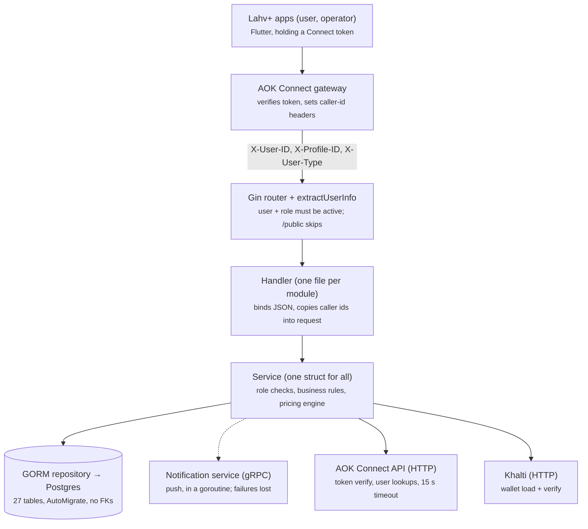
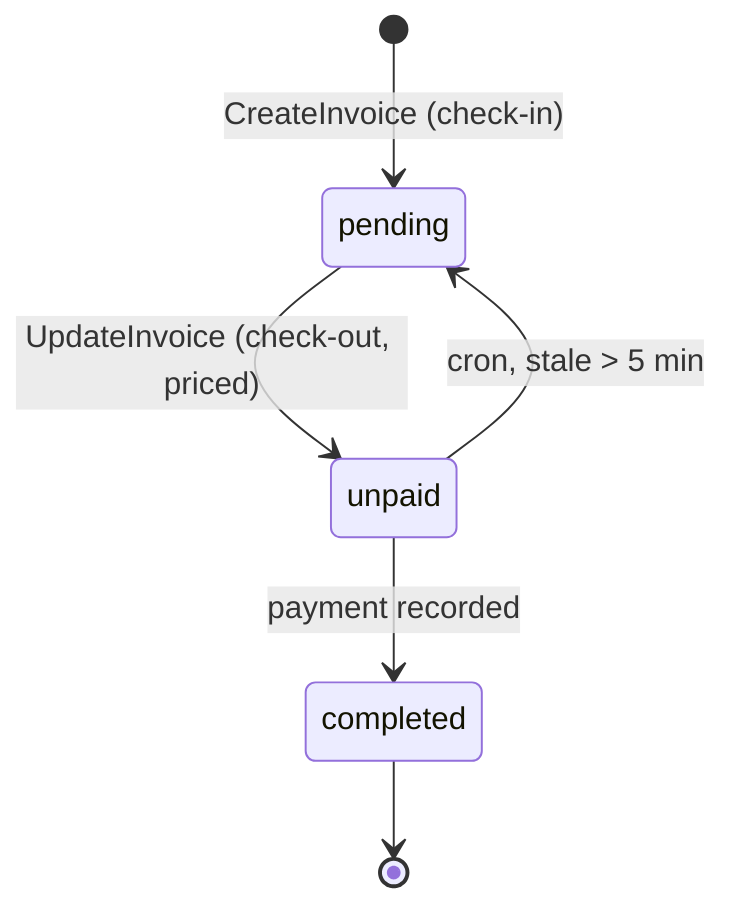
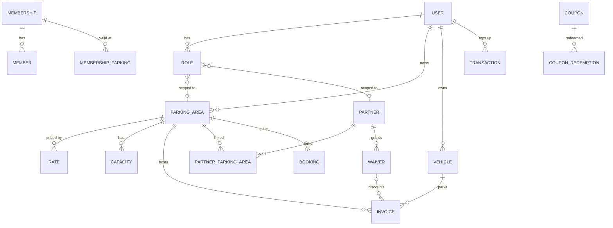
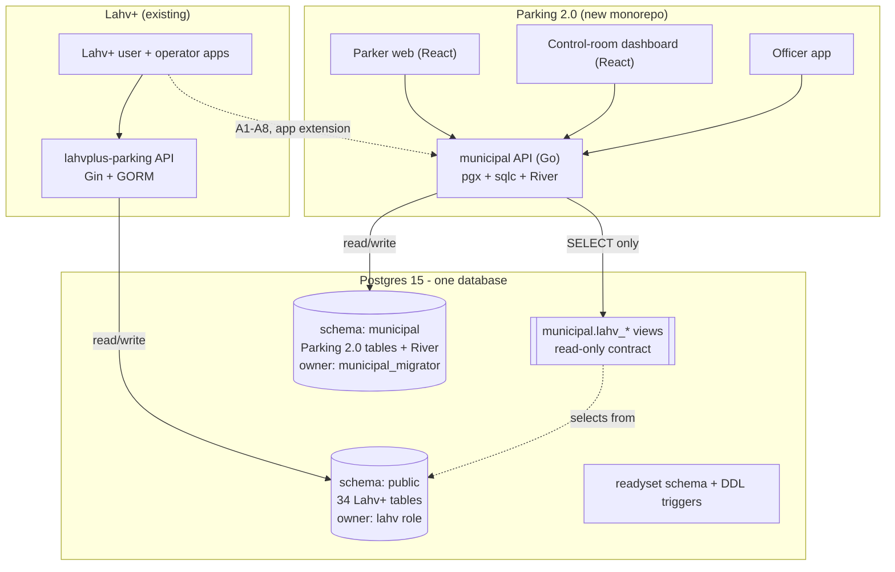
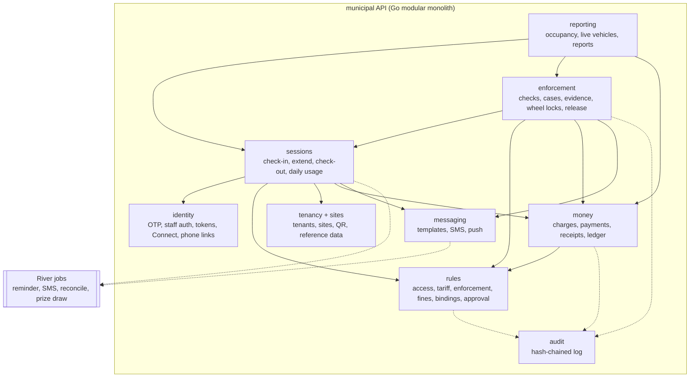
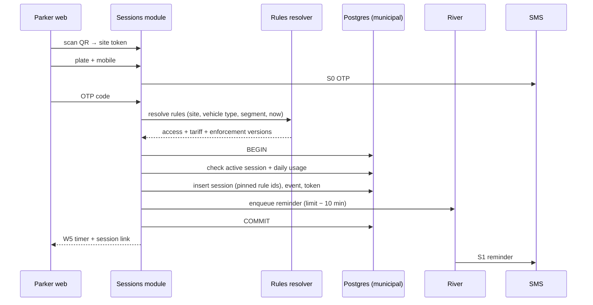
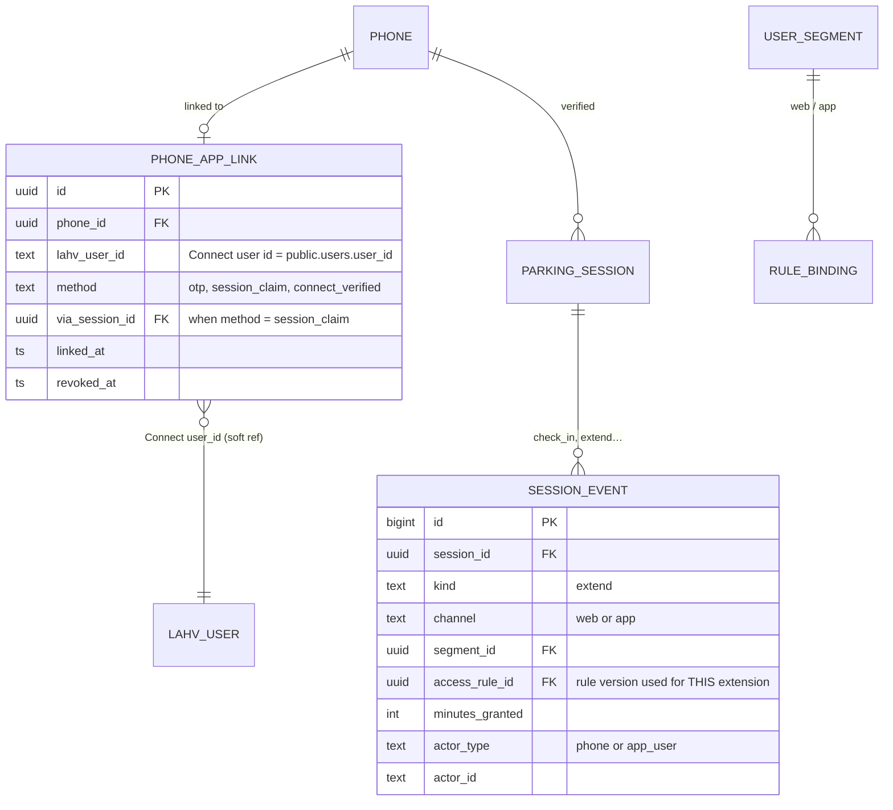
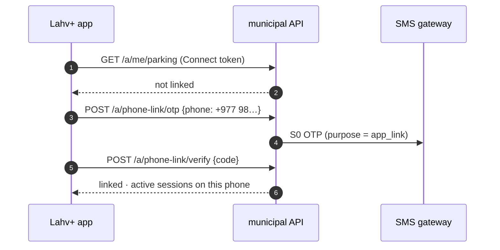
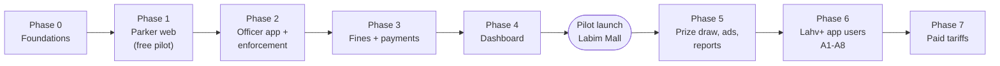

# Researched – Parking 2.0 Architecture and Plan

One document for everything researched so far: how the existing Lahv+ backend works, why Parking 2.0 is a new service, how both share one database, what the Figma needs from the backend, how Lahv+ app users get the +1 h extension, and the roadmap.

Related vault notes: [[Parking 2.0 ER Diagram]] · [[Parking 2.0 High Level Overview]] · [[User Flow- Parker Web]] · [[User Flow- App User]] · [[User Flow - Street Officer]] · [[User Flow- Yard Officer]] · [[User Flow - Control Room]]

## Contents

1. [[#1. Summary]]
2. [[#2. Current Lahv+ backend]]
3. [[#3. Decision new service, shared database]]
4. [[#4. Shared database plan]]
5. [[#5. New monorepo]]
6. [[#6. Figma to backend map]]
7. [[#7. Lahv+ app extension integration]]
8. [[#8. Roadmap]]
9. [[#9. Open decisions]]

---

## 1. Summary

- **Parking 2.0** (LMC municipal street parking; pilot at Labim Mall, 120 motorcycle bays) is built as a **new monorepo**: a Go backend and React frontends.
- It **shares the existing Lahv+ Postgres database**, isolated in its **own schema (`municipal`)** with its own DB roles and migrations. It reads a few Lahv+ tables through read-only views and **never writes to `public`**. The old backend needs no changes.
- From the existing code we **copy** the pricing engine algorithm, plate helpers, the hexagonal layout and the ADR habit. We don't share code.
- **Lahv+ app users** (Connect sign-in: email, Google, Apple) get the app perk (+1 h extension, 3 h/day) by **linking their account to a verified phone** once, via a deep link from the web session or an SMS code.
- **First milestone:** a real phone completes QR → check-in → extend → check-out at the test site (Phase 1).

---

## 2. Current Lahv+ backend

The private-lot product (`github.com/ankaek/lahvplus-parking`) serves the Lahv+ Flutter user and operator apps. It's one Go 1.23 binary with Gin REST under `/api/v1/parking` and one Postgres DB through GORM: ~31.5k lines of Go, 877 commits since Jan 2025. Identity is delegated to the AOK Connect gateway.

### 2.1 Tech stack

| Concern        | What it uses                                                                    | Where                                           |
| -------------- | ------------------------------------------------------------------------------- | ----------------------------------------------- |
| HTTP           | Gin 1.10, all routes under `/api/v1/parking`                                    | `internal/adapter/http/router.go`               |
| DB access      | GORM 1.30 + pgx driver, Postgres 15                                             | `internal/adapter/storage/postgres/db.go`       |
| Schema changes | `AutoMigrate` on startup (27 models), FK constraints disabled, hand-run SQL     | `db.go`, `patch/*.sql`                          |
| Auth           | None in-process; trusts `X-User-ID`, `X-Profile-ID`, `X-User-Type` headers      | `internal/adapter/http/middleware.go`           |
| Identity       | AOK Connect over HTTP (OAuth code exchange, token verify, user lookups)         | `helper/auth_helper.go`, `http/oauth.go`        |
| Notifications  | gRPC client to `aok-connect-notification` (push + in-app list), in goroutines   | `proto/notification`, `notification_service.go` |
| Payments       | Khalti init/verify (wallet top-up)                                              | `internal/adapter/payment`                      |
| Scheduled work | External cron calls `POST /public/cron/everyminute`                             | `invoice_service.go`                            |
| API docs       | swaggo → Swagger UI at `/docs`                                                  | `docs/docs.go`                                  |
| Errors / logs  | Sentry (gin middleware), logrus                                                 | `router.go`                                     |
| PDFs           | go-pdf/fpdf (coupons)                                                           | `helper/coupon_pdf.go`                          |
| Build          | Multi-stage Dockerfile (lint → test → build → alpine), Compose for dev, `air`   | `Dockerfile`, `Makefile`                        |

**Missing today:** Redis use (config keys exist, unused), a job queue, an object storage client (images are URL/key strings, uploaded elsewhere), SMS, OTP, PostGIS, graceful shutdown.

### 2.2 Project structure

Ports-and-adapters (hexagonal) layout, but with **one** shared `Handler`, **one** `Service` (29 composed interfaces) and **one** `Repository` (24) that every module hangs off.

```
cmd/main.go                         wiring: config → DB → gRPC client → repo → service → handler → router
internal/
  adapter/
    http/                           ~30 Gin handler files + router.go + middleware.go + oauth.go
    storage/postgres/repository/    GORM queries per module
    payment/                        Khalti client
    helper/                         Connect auth calls, plate format/mask, images, PDFs
    config/                         env config
  core/
    port/                           interfaces per module → composed into Service + Repository
    service/                        business logic, methods on a single *Service
    domain/                         GORM models + request/response DTOs + validation
    pricing/                        pure pricing engine (no DB) + tests
    constant/                       roles, statuses, media keys
proto/notification/                 gRPC contract for the notification service
docs/adr/                           25 ADRs
patch/                              hand-run SQL migrations
```

Hot spots: `service/invoice_service.go` 1,795 lines · `service/user_service.go` 988 · `repository/invoice_repository.go` 972 · `pricing/engine.go` 630. There are 22 test files, concentrated in `domain`, `pricing` and `helper`.

### 2.3 Request lifecycle and auth

The backend does no authentication itself: whoever sets the headers is the caller. It must only be reachable through the Connect gateway.



- **Middleware** (`extractUserInfo`): validates `X-User-ID` is a uuid, the user is active, and the `X-Profile-ID` role is active.
- **Authorisation** lives in services: `ApplyCallerRole`, `assertMutationAllowed`, `allowParkingStaffForLot` load the caller's `roles` row (cached in process; `POST /public/cache/reset` clears it).
- **`/public` routes** skip the middleware: public invoice view, vehicle lookup by plate, parking area list, coupon download, the per-minute cron.

### 2.4 Domain modules

The **invoice** doubles as the parking session.



- **Check-in** (`CreateInvoice`): resolve the vehicle by id or plate (auto-create from a plate) → reject if the vehicle has a `pending` invoice anywhere → load the lot's active rates → stamp the default rate and per-lot `serial_no` → auto-apply a membership waiver → audit row → push notifications.
- **Check-out** (`UpdateInvoice`): pricing engine over entry → now, waiver/discount, status forward.
- **Offline sync** (`SyncInvoices`): bulk upsert from the operator app.
- **Pricing engine** (`internal/core/pricing`, pure function, the most reusable package): lump-sum rules by priority, else time slicing across windows (pricing unit, time window, days of week, months, min/max duration, default flag), then the waiver modifier; returns subtotal, discount, total and a breakdown.

| Module                        | What it does                                                                                    |
| ----------------------------- | ----------------------------------------------------------------------------------------------- |
| Parking areas                 | Private lots: owner `user_id`, capacity per vehicle type, rates, business hours, images, contacts, GPS, verification |
| Vehicles + timelines          | Globally unique free-text `plate_number`, owner user, claim-by-plate, service timeline           |
| Users, roles, staff           | Users mirror Connect accounts; `roles` bind a user to a lot or partner; staff invited by email   |
| Partners + waivers            | Businesses that subsidise parking at linked lots; requests, approval, caps, reports             |
| Memberships                   | Member groups with vehicles, linked to lots, giving automatic waivers                           |
| Coupons, bookings             | Discount coupons with PDFs; advance booking for lots with `enabled_booking`                     |
| Transactions                  | Khalti wallet load + verify                                                                     |
| Reports / summary / dashboard | Aggregates over invoices                                                                        |

Roles: **PO** parking owner · **B** parking admin · **PS** parking staff · **WO** waiver owner · **W** waiver admin · **WS** waiver staff · **I** individual.

### 2.5 Existing database

From `uat_lahvplus_parking_schema.sql` (Postgres **15.17**, dumped 3 Nov 2026).

| Fact | Detail | Why it matters for sharing |
| --- | --- | --- |
| 34 tables, all in `public` | 27 GORM-managed + 7 legacy (`addresses`, `modules`, `permissions`, `roles_permissions`, `user_roles`, `user_partner_assignments`, `notifications`) | `roles`, `notifications`, `images`, `audit_logs` would **collide** with Parking 2.0 names in `public` |
| **0 foreign keys** | Ids are `uuid` or `text`; `user_id` is `text` everywhere | Links from Parking 2.0 are soft references |
| Few unique keys | `vehicles.plate_number` (free text); partial uniques on `users.email`, `users.user_id` | Partial unique indexes can't be FK targets; plates aren't canonical |
| Money | `numeric` (`invoices.total`, `rates.rate`); `transactions.amount` `bigint` | Parking 2.0 money stays separate, in paisa |
| Soft delete | `deleted_at` nearly everywhere | Views must filter `deleted_at IS NULL` |
| Extensions | `pg_trgm`, `uuid-ossp`; **no PostGIS** | PostGIS would be a DB-wide change |
| **ReadySet** | `readyset` schema + 7 DDL event triggers (`CREATE/ALTER/DROP TABLE`…) that replicate schema changes to a ReadySet cache and set `REPLICA IDENTITY FULL` on new tables. Not referenced in the backend code; it's infra-level | **Every migration we run fires these** |
| `users.phone_number` | Optional, typed by the user, plain text, not verified | Can't be used to identify parkers |
| AutoMigrate on startup | Runs on its 27 models when `DB_AUTO_MIGRATE != false` | Harmless to a separate schema |



### 2.6 Integrations and weaknesses

Every outside call is synchronous HTTP/gRPC from the request path or a bare goroutine: no retry, outbox or queue. Notifications are fire-and-forget; the cron is an unauthenticated public route; Khalti is wallet-only (no FonePay, webhooks or reconciliation).

Also weak: AutoMigrate + no FKs; money in floats; one god `Service`; no `context.Context`, request timeouts, rate limiting or graceful shutdown; low test coverage outside `pricing`/`domain`/`helper`. See the repo's `docs/ARCHITECTURE_REVIEW.md` and `docs/IMPROVEMENT_PLAN.md`.

---

## 3. Decision: new service, shared database

**Decision (3 Nov 2026):** Parking 2.0 is a **new monorepo** (Go backend + React frontend) that **uses the same Postgres database** as `lahvplus-parking`, isolated in its own schema.

### 3.1 Why not build it inside the existing backend

Parking 2.0 needs things the current backend has no concept of: tenants with row-level security, OTP for anonymous phone users, versioned approval-gated rules pinned on sessions, money as charges + payments in paisa, enforcement cases with append-only evidence, SMS and a transactional job queue.

| Factor | Inside the existing backend | New service |
| --- | --- | --- |
| Identity | Add OTP + cookies beside Connect header trust; two auth models in one router | OTP + session tokens from day one; Connect users via one more auth path |
| Tenancy + RLS | Retrofit onto 27 tables queried without it | Built into the first migration |
| Sessions + money | `invoices` can't carry pinned rules, charges, allocations without breaking the operator app and `SyncInvoices` | Clean session + charge + payment model in paisa |
| Rules | Versioning + approval would change every lot's pricing path | Versioned rule modules + bindings built once |
| Migrations | AutoMigrate + `patch/` SQL | goose, real FKs inside our schema, sqlc |
| Jobs | Retrofit River onto fire-and-forget goroutines | River jobs in the same transaction |
| Blast radius | A municipal deploy can break the paying private-lot product | Independent deploys and on-call |
| Code size | 1,795-line invoice service + ~60 new tables in one `Service` | Modules with their own ports |

### 3.2 Data model gap (why no Lahv+ table is reused as-is)

| Concept | Current backend | Parking 2.0 | Gap |
| --- | --- | --- | --- |
| Ownership | `parking_areas.user_id` + `roles` | `tenants → sites`, `tenant_id` everywhere, RLS | No tenancy |
| Site | lat/long floats, capacity int | boundary, capacities, QR codes | No geometry or QR |
| Plate | free-text unique `plate_number` | canonical key + EN/NE display, plate formats | No canonical form |
| People | Connect users; no verified phone | encrypted phones, parkers, OTP | Parkers are app accounts only |
| Session | `invoices`, mutable status, floats | sessions + events + tokens + daily usage, derived status | No event log or cap |
| Rules | `rates` per lot, edited in place | access / tariff / enforcement / fine rules, bindings, approvals | No versions or scopes |
| Money | `invoices.total`, `transactions` | charges, payments, allocations, receipts, ledger | No line items |
| Enforcement | none | checks, cases, evidence, wheel locks, release, disputes | Entirely new |
| Messaging | push via gRPC | templates + SMS + push | No SMS |
| Audit | free-form `audit_logs` | hash-chained `audit_log` | Not tamper-evident |

### 3.3 What we copy in (not share)

- `internal/core/pricing` → core of the tariff module (money in paisa, versioned tariff steps).
- `RefinePlateNumber` / `MaskPlateNumber` → starting point for canonical plate keys.
- `proto/notification` → push to Lahv+ app users via the existing notification service.
- Hexagonal ports per module (not one god `Service`) and the ADR practice.

**Stack note:** what matters most for correctness is **pgx + sqlc** (explicit transactions for caps and fines), **goose** (real migrations) and **River** (jobs enqueued in the same transaction). chi (handoff) or Gin (team familiarity) both work with oapi-codegen. **Don't carry GORM over.**

---

## 4. Shared database plan

### 4.1 Model



**Rules both teams follow**

1. **Each service migrates only its own schema.** `public` changes stay in the Lahv+ repo; `municipal` changes live in the new repo (goose).
2. **The new service never writes to `public`.** Link columns live on the `municipal` side.
3. **The new service reads `public` only through views** (`municipal.lahv_parking_areas`, `lahv_users`, `lahv_vehicles`), so a Lahv+ column rename breaks loudly at migration time.
4. **Separate DB roles** enforce 1–3.
5. **The old backend doesn't change.**

### 4.2 DB roles

| Role | Owns | Can do | Used by |
| --- | --- | --- | --- |
| existing app role (`aokuser` in dev config) | `public` | as today | lahvplus-parking |
| `municipal_migrator` | schema `municipal` | DDL in `municipal`; `CREATE VIEW` over granted `public` tables | goose in CI/deploy |
| `municipal_app` | nothing | CRUD on `municipal.*`; `SELECT` on `lahv_*` views | Go API + River workers |
| `municipal_readonly` (later) | nothing | `SELECT` on reporting views | D5 reports, BI |

`municipal_app` isn't the table owner, so **row-level security applies** to it: `tenant_id` + RLS without touching Lahv+.

```sql
-- sketch, run once by a DB admin
CREATE ROLE municipal_migrator LOGIN PASSWORD '…';
CREATE ROLE municipal_app      LOGIN PASSWORD '…';
CREATE SCHEMA municipal AUTHORIZATION municipal_migrator;
GRANT USAGE ON SCHEMA municipal TO municipal_app;
ALTER DEFAULT PRIVILEGES FOR ROLE municipal_migrator IN SCHEMA municipal
  GRANT SELECT, INSERT, UPDATE, DELETE ON TABLES TO municipal_app;
ALTER DEFAULT PRIVILEGES FOR ROLE municipal_migrator IN SCHEMA municipal
  GRANT USAGE, SELECT ON SEQUENCES TO municipal_app;
GRANT USAGE ON SCHEMA public TO municipal_migrator;
GRANT SELECT ON public.parking_areas, public.users, public.vehicles TO municipal_migrator;
ALTER ROLE municipal_app SET search_path = municipal;
ALTER ROLE municipal_app SET statement_timeout = '15s';
```

### 4.3 Where the two systems touch

| Link | Parking 2.0 side | Lahv+ side | Phase |
| --- | --- | --- | --- |
| Nearby private lots (W9 "7 other parking lots within 1.5 km", W16b) | `municipal.lahv_parking_areas` view, haversine on `gps_lat/gps_long` | `public.parking_areas` (+ `rates`) | 1 |
| App user = parker, app +1 h extension | `phone_app_links.lahv_user_id` (soft ref); see [[#7. Lahv+ app extension integration]] | `public.users.user_id` (Connect id) | 6 |
| App user's saved bike (A2) | `plates.lahv_vehicle_id` (soft ref) | `public.vehicles.id` | 6 |
| Push to app users (A5, A7) | messaging adapter | notification gRPC service | 6 |
| Municipal site on the Lahv+ map (optional) | `sites.lahv_parking_area_id` | a `parking_areas` row created by the Lahv+ side | later |

### 4.4 `municipal` schema – v1 tables

Trimmed from [[Parking 2.0 ER Diagram]] for the pilot. Hardening-only fields are left out.

| Area | Tables | Figma |
| --- | --- | --- |
| Tenancy + places | `tenants`, `sites`, `site_capacities`, `site_qr_codes`, `impound_yards` | W1, D7 |
| Reference data | `vehicle_types`, `plate_formats`, `user_segments`, `violation_types`, `action_types`, `holidays` | W2/W2b/W17, D8 |
| Rules | `access_rules`, `tariffs`, `tariff_steps`, `enforcement_rules`, `fine_items`, `rule_bindings`, `rule_changes`, `tenant_settings`, `special_windows` | W1, W8, W16, D4, D8 |
| Identity | `phones`, `otp_challenges`, `parkers`, `plates`, `phone_app_links`, `staff_roles`, `staff`, `staff_sites`, `shifts`, `auth_sessions` | W3/W3b/S0, 1.1–1.3, 6.3, D6, A1 |
| Sessions | `parking_sessions`, `session_events`, `session_tokens`, `plate_day_usage` | W4–W16, 2.x, D2 |
| Enforcement | `officer_checks`, `enforcement_cases`, `case_events`, `case_evidence`, `release_checks`, `wheel_locks`, `wheel_lock_uses`, `disputes` | W19–W24, 3.x–6.x, D3 |
| Money | `charges`, `payment_providers`, `payments`, `payment_allocations`, `receipts`, `ledger_entries` | W21–W23, 5.3–5.5 |
| Messaging + support | `message_templates`, `messages`, `ticket_categories`, `support_tickets` | S0–S4, W6b/W6c |
| Engagement | `prize_periods`, `prize_entries`, `prize_draws`, `ad_campaigns`, `ad_creatives` | ad slot, W13/W14 |
| Platform | `audit_log` (hash-chained), `code_counters`, River's `river_*` tables | — |

**Found in the Figma, not in the ER diagram:**

- **`case_events`**: W22's tracker (fine paid → officer assigned → officer on the way → lock removed) needs timestamped events per case.
- **`code_counters`**: case codes look like `IMP-20261028-0042` / `WL-20261028-0017`, a per-tenant, per-day, per-type sequence incremented in the case-insert transaction.
- **Session tokens:** W5 shows `lplus.np/s/7KQ2`. Keep the short code for display; the real key is a 32-byte random token (hash stored).

Every tenant-scoped table carries `tenant_id` with an RLS policy `tenant_id = current_setting('app.tenant_id')::uuid`, set per transaction. (`phones` and `phone_app_links` are global: one person parks in many cities.)

### 4.5 Risks of sharing the DB

| Risk | What could happen | Mitigation |
| --- | --- | --- |
| **ReadySet DDL triggers** | Our migrations fire `readyset.*` triggers; new tables get `REPLICA IDENTITY FULL` and replicate to the cache; River tables churn heavily | Ask the ReadySet owner to **exclude schema `municipal`**. Verify in UAT before the first prod migration |
| Connecting through ReadySet | River needs `LISTEN/NOTIFY` and `SKIP LOCKED`; cached reads can be stale for cap checks | `municipal_app` connects **directly to the primary** |
| Name collisions | `roles`, `notifications`, `audit_logs` exist in `public` | Separate schema; `search_path = municipal` |
| Old AutoMigrate | — | Only touches its 27 models in `public`. Recommend `DB_AUTO_MIGRATE=false` in prod anyway |
| Noisy neighbour | A heavy D5 report slows Lahv+ | Per-role `statement_timeout`, indexed read models, read replica later |
| Connection limits | Two pools on one server | Size pools explicitly (old: 25); check `max_connections`; PgBouncer if needed (session mode for River) |
| PostGIS | DB-wide extension, elevated rights, ReadySet may not replicate geography types | **Pilot without PostGIS**: site boundary as GeoJSON `jsonb` + centroid lat/lng, point-in-polygon in Go |
| Lahv+ renames a column | Nearby lots break | Reads go through views; CI runs migrations against the real `public` shape |
| Backup / restore | Restoring one rolls back both | PITR on the shared server; per-schema logical dumps |
| Locking shared tables | A bad migration blocks Lahv+ | Never DDL on `public`; `CREATE INDEX CONCURRENTLY` in `municipal` |

---

## 5. New monorepo

```
lahvplus-municipal/                 (name TBD)
  backend/
    cmd/api/                        HTTP server
    cmd/worker/                     River workers (or one binary with a flag)
    internal/
      platform/                     config, slog, sentry, pgx pool, tx helper, tenant ctx, auth middleware
      identity/                     OTP, staff auth, parker session tokens, dashboard cookies, Connect verifier, phone links
      tenancy/                      tenants, sites, QR, reference data
      rules/                        access, tariff, enforcement, fines, bindings, approvals, resolver
      pricing/                      engine ported from lahvplus-parking (paisa)
      sessions/                     check-in, extend, check-out, plate-day usage, derived status
      enforcement/                  checks, cases, evidence, wheel locks, release, disputes
      money/                        charges, payments, receipts, ledger, FonePay + cash
      messaging/                    templates, SMS adapter, push adapter (notification gRPC)
      engagement/                   prize draw, ad slot
      reporting/                    dashboard read models
      lahv/                         read-only access to municipal.lahv_* views
    db/
      migrations/                   goose, municipal schema only
      queries/                      sqlc .sql per module
      sqlc.yaml
  frontend/
    parker-web/                     React + Vite + TS, tiny bundle (< ~100 KB JS)
    dashboard/                      React + Vite + TS, shadcn/ui, TanStack
    officer/                        see open decisions
    packages/api-client/            generated from api/openapi.yaml
    packages/tokens/                Figma tokens
  api/openapi.yaml                  spec-first contract
  docker-compose.yml                postgres 15 (+ UAT schema), minio, api, worker
```

**Local dev:** compose loads `uat_lahvplus_parking_schema.sql` first (ReadySet triggers stripped), then runs our goose migrations, so every developer and CI run tests against the real shared shape.

### Module map



### Check-in, the first slice to build



---

## 6. Figma to backend map

Source: Figma page **"LMP - Pilot Project"**, two frames: **"Demo for LMP Officers"** (officer app 1.1–6.3, dashboard D1–D8; the title still says "LMU", a naming cleanup) and **"Parker journey v2 — after review comments (LMC, Labim Mall pilot)"** (W1–W24, S0–S4, A1–A8).

### 6.1 What the parker designs tell the backend

- **Time model on the parker side:** web = 2 h + one 30-min extension (2.5 h/day); app = 2 h + one 1-hour extension (3 h/day). The officer app still shows "re-check-in, 4 h cap", so the contradiction is still open.
- **Case codes:** `IMP-YYYYMMDD-NNNN`, `WL-YYYYMMDD-NNNN` → `code_counters`.
- **W9 / W16b nearby lots** come from Lahv+ `parking_areas`, the one real cross-system read.
- **W22 tracker** → `case_events`.
- **W21 "Waiting for payment…"** → FonePay webhook + status polling.
- **W5's 4-char link** is display-only; the real token is long and random.
- **W17 "1 to 4 digits"** and other copy come from `plate_formats` / templates, not hardcoded values.
- **Ad slot "Free Public Parking by LMC"** on W1/W5/W6 → `ad_campaigns` is in pilot scope.

### 6.2 Parker web (`/p/*`)

| Section | Screens | API | Module |
| --- | --- | --- | --- |
| 1 Arrive and check in | W1 | `GET /p/sites/{qrToken}` → site, rules summary, tariff, ad | tenancy, rules, engagement |
| | W2, W2b, W17, W15, W16 | `POST /p/checkins/validate` (plate format, already parked, daily cap) | sessions, rules |
| | W3, S0, W3b | `POST /p/otp` · `POST /p/otp/verify` | identity, messaging |
| | W4 → W5 | `POST /p/sessions` → token + short code; enqueue S1 | sessions |
| 2 While parked | W5–W11, W18 | `GET /p/s/{token}` → derived state + server time | sessions |
| | W8 → W9 | `POST /p/s/{token}/extend` | sessions, rules |
| | W9, W16b | `GET /p/nearby-lots?site=…` | lahv |
| | W6b | `POST /p/s/{token}/reports` | messaging (support) |
| | W6c | `GET /p/s/{token}/whereabouts` | enforcement |
| 3 Leaving | W12 → W13 | `POST /p/s/{token}/checkout` → summary + prize entry | sessions, engagement |
| | W14 | `GET /p/prize/current` | engagement |
| 5 Impound / wheel lock | S2 → W19, S3 → W20 | `GET /p/cases/{code}?t=…` | enforcement |
| | W21 | `POST /p/cases/{code}/payments` → FonePay QR; poll `GET …/payments/{id}` | money |
| | — | `POST /webhooks/fonepay` | money |
| | W22 → W23, S4 | `GET /p/cases/{code}` (events) · `GET /p/receipts/{id}.pdf` | enforcement, money |
| | W24 | `POST /p/cases/{code}/disputes` | enforcement |

### 6.3 Officer app (`/o/*`) and dashboard (`/d/*`), outline

- **Officer:** `POST /o/auth/otp`, `/verify`, `POST /o/shifts`, `GET /o/sites/{id}/vehicles?status=`, `POST /o/checks` (plate → verdict 3.3–3.6), `POST /o/cases`, `POST /o/cases/{id}/evidence` (presigned upload + hash), `POST /o/cases/{id}/release`, `POST /o/wheel-locks/{id}/remove`, `GET /o/log`, `POST /o/shifts/{id}/end`.
- **Dashboard:** `GET /d/overview`, `/d/vehicles` (never returns phones), `/d/cases`, `/d/special-windows`, `/d/reports`, `/d/staff`, `/d/shifts`, `/d/sites`, `/d/settings`, `POST /d/rule-changes`, `POST /d/rule-changes/{id}/approve`.

### 6.4 Background jobs (River, enqueued in the same transaction)

| Job | Triggered by | Screen |
| --- | --- | --- |
| `send_sms` with retry | OTP, case created, payment received | S0–S4 |
| `session_reminder` at `limit_ends_at − reminder_lead` | check-in, extend | S1, A5 |
| `payment_reconcile` | payment pending > N min | W21 |
| `prize_draw` | end of prize period | W14 |
| `evidence_verify` | evidence upload complete | 4.2–4.4 |
| `revoke_stale_app_links` (nightly) | Lahv+ user deleted/inactive | — |

Session status (active / expiring / grace / overstay / severe) is **derived on read** from times + pinned rules. No status-flipping cron.

---

## 7. Lahv+ app extension integration

**Goal:** a parker who checked in on the web can open the **Lahv+ Parking app** and get the app perk (**one 1-hour extension, 3 h/day**) on *their* session, identified by the phone they verified at check-in.

### 7.1 What the design says

| Screen | What it shows |
| --- | --- |
| v2 header | "Web: 2h + one 30-min extension (2.5h/day) · App: 2h + one 1-hour extension (3h/day) · App download prompts" |
| W5 | "Get reminders in the app" |
| W8 | "This is your only extension today" + "Lahv+ Parking App users can extend by 1 hour (3 hours a day)" |
| W9 | "Get the app" card |
| W16 vs W16b | Daily limit: web 2.5 h, app 3 h |
| A2 → A4 | App user scans the site QR, vehicle pre-selected, checks in, extends +1 h |

### 7.2 Lahv+ app identity

- Login is **OAuth against AOK Connect** via the hosted "Sign in with Connect Persona" page ("To continue to Lahv+ Parking"). The app gets an `access_token` (Bearer, `expires_in` 3600) + `refresh_token`.
- **Sign-in methods (confirmed 3 Nov 2026):** email + password, **Continue with Google**, **Continue with Apple**. **No phone sign-in.** The Connect Persona app is optional for users.
- The Connect user payload carries **id, email, name, image. No phone number.**
- **Email can't be the join key either:** Apple's "Hide My Email" gives a relay address, and web parkers never enter an email.
- `public.users.phone_number` is optional, user-typed and **not verified**.
- The token example in code is `eyJhbGciOiJIUzI1NiIs…` (HS256 JWT). If that's real, local verification needs Connect's shared secret.

**Consequence:** the app must **prove possession** of the phone (or of the session) once, and we store that link.

### 7.3 Model



- **`phone_app_links`:** one active link per phone, one per Connect user (partial unique indexes on `revoked_at IS NULL`). Not tenant-scoped.
- **Two segments** per tenant: `web`, `app`. **Two access rules bound by segment:**

| Rule | Segment | `extensions_allowed` | `extension_min` | `daily_cap_min` |
| --- | --- | --- | --- | --- |
| Pilot – web | `web` | 1 | 30 | 150 |
| Pilot – app | `app` | 1 | 60 | 180 |

"App gets 1 hour" is a rule binding, not code. LMC can change it (with approval).

### 7.4 Three ways a phone gets linked

| # | Method | When | Proof | Cost |
| --- | --- | --- | --- | --- |
| A | **Session claim via deep link** | User taps "Get the app" on W5/W8/W9 during a web session | Holds the session link token | Free, one tap |
| B | **OTP in the app** | Opens the app later, deep link lost on install, or app-first check-in (A2/A3) | 6-digit SMS code | 1 SMS |
| C | **Connect-verified phone** (future) | Only if Connect adds phone sign-in/verification and returns it in `/me` | Connect's verification | Free, automatic |

Ship **A + B** for the pilot. C isn't possible today. The link step is a one-time "Add your parking number" screen after Connect sign-in; via the deep link it's invisible. The Connect sign-in page and existing Lahv+ flows don't change.

**A – Session claim (web → app)**

```mermaid
sequenceDiagram
  autonumber
  participant W as Parker web (W8/W9)
  participant App as Lahv+ app
  participant C as AOK Connect
  participant API as municipal API
  participant DB as municipal schema

  W->>W: "Extend by 1 hour in the app" tapped
  W->>App: open https://lplus.np/a/claim?s=<session token><br/>(App Link / Universal Link; Play Store with install referrer if not installed)
  App->>C: sign in (email / Google / Apple), as today
  C-->>App: access token
  App->>API: POST /a/phone-link/claim {session_token}<br/>Authorization: Bearer <Connect token>
  API->>C: verify token (cached 60 s)
  C-->>API: user_id
  API->>DB: session token valid + session active?<br/>phone not linked to another app user?
  API->>DB: INSERT phone_app_links (method = session_claim)
  API-->>App: linked · phone ••••567 · active session
  App->>API: POST /a/sessions/{id}/extend
  API->>DB: resolve access rule for segment = app<br/>check plate_day_usage, extensions_count
  API->>DB: UPDATE limit_ends_at +60 min<br/>INSERT session_event (channel = app, rule = Pilot-app)<br/>re-enqueue reminder job
  API-->>App: A4 timer, ends 12:10
```

**B – OTP in the app**



After either path, `GET /a/sessions/active` returns sessions on the linked phone, plus sessions on plates matching the user's Lahv+ vehicles (`municipal.lahv_vehicles`, A2 "vehicle pre-selected").

### 7.5 How the extension rules resolve

The segment is decided by **who performs the action**, not where the session started.

| Action | Authenticated as | Segment |
| --- | --- | --- |
| Check-in on web (W4) | session OTP (phone) | `web` |
| Check-in in app (A3) | Connect token + linked phone | `app` |
| Extend on web (W8) | session token | `web` |
| Extend in app (A4/A5) | Connect token + linked phone | `app` |

In one transaction: lock the session and plate-day usage → resolve the access rule for (site, vehicle type, actor's segment, now) → check `extensions_count < extensions_allowed` and `minutes_granted + extension_min ≤ daily_cap_min` → bump `limit_ends_at`, write a `session_event` pinning **that** rule version, re-enqueue the reminder.

**Worked example:** web check-in 09:10 → ends 11:10. At 10:55 the parker claims the session in the app and extends: +60 → ends 12:10, 3 h used, the app's daily cap. On the web they'd get +30 → 11:40, 2.5 h.

**Edge cases**

- **Already extended on the web, then opens the app.** Recommendation: one extension per plate per day across channels. Alternative: an app top-up to 60 min. One rule flag either way.
- **W10 grace** ("can still extend once") applies in the app too.
- **Check-out from the app** of a web session: allowed once linked; `checkout_source = app`.
- **Different phone in the app than at check-in:** the web session stays invisible unless claimed via the deep link. That's correct: the session belongs to the phone that verified it.

### 7.6 Authenticating Connect tokens

| Option | How | Pros | Cons |
| --- | --- | --- | --- |
| 1. Verify the JWT locally | Validate the signature, read `user_id` | No network hop | HS256 means sharing Connect's secret; better if Connect signs RS256/EdDSA and publishes a JWKS |
| **2. Introspect via Connect** (pilot) | `GET {CONNECT}/api/v1/auth/verify_token`, cache ≤ 60 s | Works today, no secret sharing | Latency; Connect is a runtime dependency |
| 3. Route through the Connect gateway | Gateway forwards `X-User-ID` | Same as today | Header trust is fragile |

Put it behind an `identity.ConnectVerifier` port so option 1 can replace it later. Only `/a/*` routes accept Connect tokens. After verification, load `public.users` via `municipal.lahv_users` and check `status`/`is_active`.

### 7.7 App API (`/a/*`, Connect bearer)

| Endpoint | Screen | Purpose |
| --- | --- | --- |
| `GET /a/me/parking` | A1 | Link status, phone last-4, active session summary |
| `POST /a/phone-link/claim` `{session_token}` | W5/W8/W9 deep link | Link via session possession |
| `POST /a/phone-link/otp` · `/verify` | first use | Link via OTP |
| `DELETE /a/phone-link` | settings | Unlink |
| `GET /a/sites/{qrToken}` | A2 | Site + app-segment rules |
| `POST /a/sessions` | A3 | Check in with a saved vehicle or typed plate |
| `GET /a/sessions/active` | A4 | Sessions on the linked phone |
| `POST /a/sessions/{id}/extend` | A4, A5 | Extension under app rules |
| `POST /a/sessions/{id}/checkout` | A6 | Check out + prize entry |
| `GET /a/cases/{code}` | A7 | Impound alert detail |
| `GET /a/history` | A8 | Past sessions on the linked phone |

### 7.8 Notifications and safety

- **Reminders (S1/A5):** push via the existing notification gRPC (`receiverID = Connect user_id`), SMS fallback on failure.
- **Impound / wheel lock (S2/S3 → A7):** always SMS plus push.
- **Web "Get the app" prompts** render only when the site's `app` binding beats `web`.

| Risk | Guard |
| --- | --- |
| Claiming someone else's session | Needs the ≥ 32-byte session token; the 4-char code is never accepted |
| One account farming many phones | One active link per Connect user; relinks rate-limited (e.g. 3 / 30 days) |
| OTP pumping | Valid Connect token + per-user and per-phone rate limits |
| Shared family phone | Link is per phone; acceptable for pilot |
| Lahv+ account deleted | Nightly job revokes links for inactive/deleted users |

### 7.9 Work items by team

**Parking 2.0 repo**

- [ ] Migration: `phone_app_links`; `session_events` gains `channel`, `segment_id`, `access_rule_id`, `minutes_granted`; seed `web`/`app` segments, two pilot access rules + bindings
- [ ] Views `municipal.lahv_users`, `municipal.lahv_vehicles`
- [ ] `identity.ConnectVerifier` (introspection + 60 s cache)
- [ ] `/a/*` routes in the OpenAPI spec
- [ ] Rule resolver takes the actor's segment
- [ ] Push adapter over the copied notification proto
- [ ] Web "Extend in the app" CTA builds `https://lplus.np/a/claim?s=<token>`

**Lahv+ Flutter app**

- [ ] Android App Links / iOS Universal Links for `lplus.np/a/*`; Play Install Referrer for fresh installs
- [ ] "Municipal parking" entry (A1) → link flow → A2–A8 calling the new API with the existing Connect token

**AOK Connect**

- [ ] Confirm token format; JWKS possible?
- [ ] (Future) phone sign-in/verification + `phone_verified` in `/me`

**Lahv+ backend:** nothing required.

---

## 8. Roadmap



| Phase | Scope | Done when |
| --- | --- | --- |
| **0 Foundations** | Monorepo scaffold; DB roles + `municipal` schema on UAT; ReadySet exclusion confirmed; compose with UAT schema; goose + sqlc + River; OpenAPI skeleton; CI migrates against the real `public` shape | `GET /healthz` on UAT, first migration applied, Lahv+ unaffected |
| **1 Parker web** | Tenancy, reference data, rules (free tariff), OTP, sessions; W1–W18, S0, S1; nearby-lots view | A real phone completes QR → check-in → extend → check-out |
| **2 Officer app** | Staff auth, shifts, live list, verdicts, cases, evidence, wheel locks; 1.x–4.x, 6.x | Officer records an impound with 2 photos; parker gets S2 |
| **3 Fines + payments** | Charges, FonePay QR + cash, receipts (BS fiscal year), yard release; W19–W24, 5.x, S2–S4 | Fine paid by QR, lock removed, receipt SMS sent |
| **4 Dashboard** | D1–D3, D6–D8, rule change + supervisor approval | Grace change pins on new sessions only |
| **5 Extras** | Prize draw, ads, D4 special enforcement, D5 reports | — |
| **6 App users** | §7: Connect verifier, phone links, `/a/*`, push | Web session extended +1 h from the app |
| **7 Paid parking** | Non-zero tariffs, prepay (pending Nischhal's design) | — |

**Immediate next steps**

1. Agree on the schema name and DB roles; confirm the ReadySet exclusion.
2. Migration `0001` (tenants, sites, QR, reference data, phones, plates, staff) + the `lahv_parking_areas` view.
3. OpenAPI spec for parker journey Section 1 (W1 → W5).

### Risks

- **Time model undecided:** build both counters; keep defaults in config.
- **SMS aggregator and hosting** block Phase 1 launch; ask LMC early.
- **Two Go backends** with a small team: keep the new one strict (sqlc, migrations, testcontainers).
- **Plate OCR** is unproven on Nepali plates; it's out of v1, but leave a plate-normalisation seam.

---

## 9. Open decisions

**For Amit dai / LMC**

- [ ] Extension vs re-check-in time model and cap values (parker screens: extension; officer app: re-check-in, 4 h)
- [ ] Cap scope: per site or city-wide
- [ ] App extension after a web extension: one per day across channels, or a top-up?
- [ ] Can the app check in without linking a phone? (recommend no)
- [ ] Payment timing for paid sites (prepay recommended); merchant account owner
- [ ] SMS aggregator (Sparrow / Aakash); hosting

**For engineering**

- [ ] Officer app: React Native + Expo, or a React PWA in the monorepo (recommend PWA for pilot if OCR stays out)
- [ ] Schema name: `municipal`, `civic` or `lmc`
- [ ] Router: chi or Gin
- [ ] Who administers ReadySet; can `municipal` be excluded?
- [ ] Can we create roles and schemas on UAT/prod ourselves?
- [ ] iOS deferred deep links: OTP fallback, or a vendor?

**For AOK Connect**

- [ ] Token format (HS256 shared secret vs a published JWKS)
- [ ] Phone sign-in / `phone_verified` (future auto-linking)

**For Nischhal (design)**

- [ ] Paid parking design; missing screens (supervisor approval, support inbox, dispute review, vehicle-type capture); LMU → LMC naming cleanup
